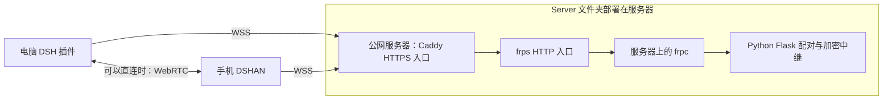

# DSHAN Server

独立部署在公网服务器的配对、信令和加密中继服务。开发者：炽阳001。

手机 DSHAN 和电脑 DSH 都只是客户端。电脑创建配对二维码/配对码，手机扫描或输入后，双方连接这里的服务，优先 P2P，无法直连时自动使用端到端加密中继。服务不执行 Harness 工具，也没有解密工具数据的密钥。



## 文件

- `app.py`：Flask HTTP 和原生 WebSocket 服务，兼容已有 DSH Peer 协议。
- `frp/`：原 FRP 整个目录的本地副本、新版服务端/客户端模板、官方 Linux FRP 文件夹。
- `compose.yml`、两个 Dockerfile、`Caddyfile`：Linux 一起启动 Flask、frps、frpc 和 HTTPS。
- `configure.py`：生成私有部署配置和随机 FRP token，不覆盖已有配置。
- `start.bat`、`stop.bat`：Windows 服务器一键启动/停止 Flask 与既有 FRP 隧道（纯批处理）。
- `bootstrap.py`：供 `start.bat` 调用的环境检查小工具。
- `tests/`：房间鉴权、隔离、过期、断线和既有插件互通验收。

## Linux 公网服务器部署

需要 Docker Compose 和 Python 3。将域名的 A/AAAA 记录指向这台服务器，开放 TCP 80/443。80/443 已被其他网站使用时，应把 WSS 代理规则接入现有反向代理，不能再启动第二个占用相同端口的 Caddy。

上传 `Server` 整个目录，在目录内执行：

```sh
python3 configure.py --domain pair.example.com --email your-email@example.com
docker compose up -d --build
docker compose ps
curl -i https://pair.example.com/health
```

健康检查应返回 HTTP 200、`ok` 和 `X-DSH-Peer-Relay: 1`。手机/电脑插件使用 **`wss://pair.example.com/peer`**。电脑调用 `peer_host` 生成二维码，手机在 **设置 → 连接** 中配对，选择允许共享的工具。使用 WSS 时无需开启手机的“允许 HTTP 配对服务”。

默认只公开 HTTPS 所需端口；7000、8080、8787 均位于服务器 Docker 内部网络。frps 和 frpc 之间使用 TLS 和随机 token；不对公众开放 FRP 管理面板。这里只让服务器自己的 frpc 注册 Flask 服务，用户电脑无需 FRP 配置，也不用运行配对服务器。

首次 Docker 构建会下载固定 FRP 0.71.0，支持 Linux AMD64/ARM64，并验证官方发布的摘要。部署包已附带完整官方 AMD64 压缩包 `frp/frp_0.71.0_linux_amd64.tar.gz`。也可在目标服务器运行 `python3 download_frp.py --arch amd64 --extract` 提取整个官方 FRP 文件夹，以便不使用 Docker 时管理二进制文件；该目录不是 Windows 程序。

查看服务状态：`docker compose logs --tail 100 peer frpc frps gateway`。修改域名/token 后需 `docker compose up -d --force-recreate`；会中断配对连接，双方重新配对。常规重启：`docker compose restart`。停止：`docker compose down`；保留证书卷。

## 使用原 FRP 地址部署到 Windows 服务器

原目录中的 `frpc.exe` 和 `frpc.ini` 已原样保留在 `Server/frp`。在 **服务器** 上安装 Python 3.13，执行：

```bat
start.bat /setup
start.bat
```

首次运行会自动创建 `.venv` 并安装依赖。将原 `frp` 目录中的 `frpc.exe` 复制到 `Server\frp`，再参考 `frp\frpc.ini.example` 创建 `frpc.ini`。自检：`start.bat /check`。停止：服务窗口按 Ctrl+C，再执行 `stop.bat`。

Flask 默认监听服务器的 `127.0.0.1:16580`，对应现有 FRP 配置的本地端口。若配置的端口不同，先设置 `$env:PORT='实际端口'`。此 Windows 启动方式适合兼容现有 FRP 的验收；正式公网部署优先使用上面的 Docker/Gunicorn。服务进程和 frpc 必须在服务器持续运行。

原配置若只提供 HTTP 域名，插件可用 `ws://原域名/peer`，两端显式允许 HTTP 配对服务；数据仍由已有插件端到端加密。需要 HTTPS/WSS 时，在 FRP 公网入口配置 TLS，或用指向自有服务器的域名按 Linux 方案部署。单纯把 Flask 换到服务器不会自动给原 FRP 提供商的域名增加证书。

如果原入口仍连接旧测试电脑，应先在服务器启动 Flask 并检查本机健康接口，然后停止旧电脑上相同配置的 frpc，最后在服务器启动 frpc，避免同一个代理名被两台机器同时注册。入口验证成功后，双方重新生成配对码。原 ChmlFrp 的 Windows 客户端不能在 Linux 运行；沿用该提供商时需要它提供的兼容 Linux 客户端，不能直接以新版官方 frps 替换提供商的服务。

## 运行与容量

Gunicorn 固定一个进程、128 个线程，默认最多 96 个 WebSocket 连接（完整配对占两个）。房间状态在内存中；单机启动即可，不能仅增加 worker 或实例数量，否则两端可能落在不同进程而无法配对。横向扩容需要共享房间注册和消息总线，未作为本版本实现。

限制包括：加入窗口 5 秒、等待配对 10 分钟、控制信令总量、128 KiB 帧、单方向每秒 32 MiB、发送队列上限和 WS 心跳。配对成功后的在线连接不受等待配对期限影响。0.1.7 插件使用各端独立的恢复令牌，在临时断线后保留最长 24 小时的房间恢复资格；每轮握手验证两端新生成的随机数，防止旧信令跨连接重放。手动断开会撤销房间并通知双方停止重连；旧客户端没有恢复令牌，仍沿用断线撤销行为。

服务器重启会清空内存状态。两端 0.1.7 插件在仍运行时可自动重新加入并协商；客户端进程退出后需要重新配对。升级时需同时更新手机与电脑插件，并重启 Python 服务加载新的 `app.py`。沿用当前 FRP 进程时，在原 Python 服务窗口按 Ctrl+C，然后执行 `start.bat /nofrp`，不要使用会结束所有 frpc 进程的旧 `stop.bat`。

服务不记录配对码、room access、SDP 或工具内容，不提供允许任意人查看房间/控制设备的管理接口。手机原有 ADB/Shizuku、设备控制和共享工具白名单仍由客户端检查。

## 验证

安装 `pytest` 后执行 `python -m pytest tests -q`。插件互通测试：先在本机运行 `app.py`，在项目根目录执行 `node Server/tests/interop.mjs`；仅用于测试，本机配对地址为 `ws://127.0.0.1:16580/peer`。测试不会调用模型 API 或操控真实手机。

部署依据：[Flask-Sock 文档](https://flask-sock.readthedocs.io/en/latest/)、[FRP 配置和校验文档](https://gofrp.org/en/docs/features/common/configure/)。公网是否可达必须在真实部署后检查；本地互通结果不代表域名、证书或服务器防火墙已配置好。
